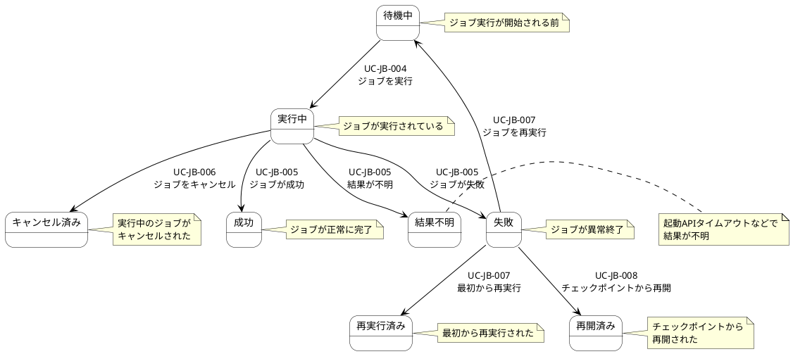

# ステートマシン図 - ジョブ実行

ジョブ実行の状態遷移をPlantUMLで視覚化します。

## 状態遷移図

## 状態一覧

| 状態名         | 説明                                | 遷移元 | 遷移先                               | トリガーUC           |
|----------------|-------------------------------------|--------|--------------------------------------|----------------------|
| 待機中         | ジョブ実行が開始される前            | -      | 実行中                               | UC-JB-004            |
| 実行中         | ジョブが実行されている              | 待機中 | 成功, 失敗, 結果不明, キャンセル済み | UC-JB-005, UC-JB-006 |
| 成功           | ジョブが正常に完了                  | 実行中 | -                                    | -                    |
| 失敗           | ジョブが異常終了                    | 実行中 | 待機中, 再実行済み, 再開済み         | UC-JB-007, UC-JB-008 |
| 結果不明       | 起動APIタイムアウトなどで結果が不明 | 実行中 | -                                    | -                    |
| 再実行済み     | 最初から再実行された                | 失敗   | -                                    | UC-JB-007            |
| 再開済み       | チェックポイントから再開された      | 失敗   | -                                    | UC-JB-008            |
| キャンセル済み | 実行中のジョブがキャンセルされた    | 実行中 | -                                    | UC-JB-006            |
