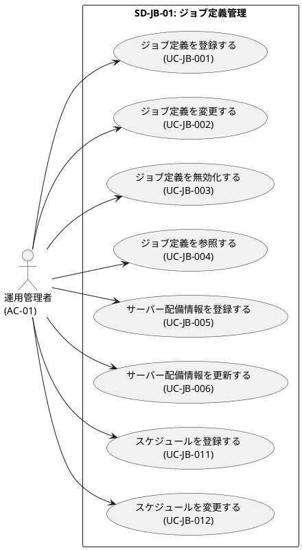
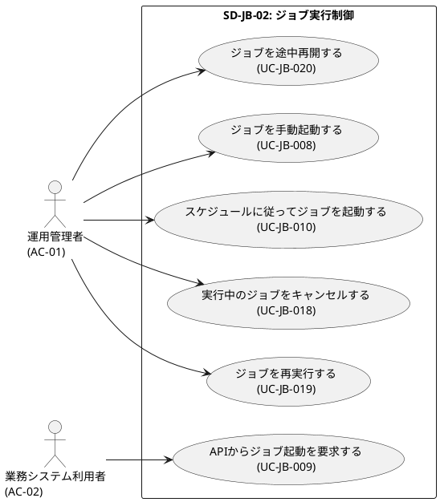
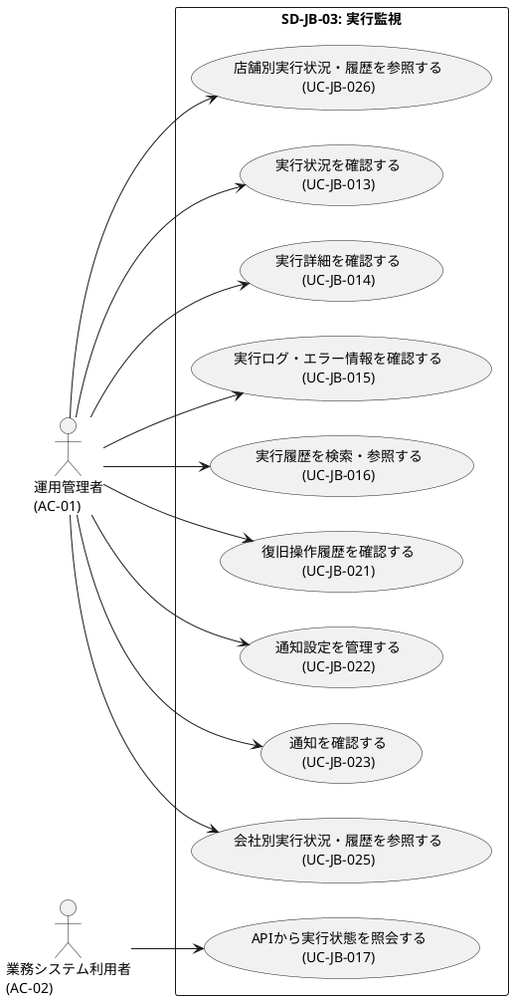
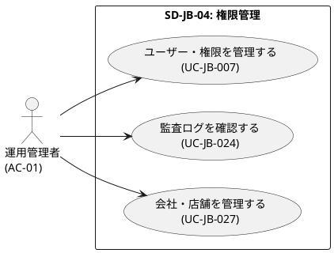

# サブドメイン毎ユースケース図

JBジョブ管理の4つのサブドメインごとにユースケース図をPlantUMLで定義します。

## 1. SD-JB-01: ジョブ定義管理

**サブドメイン:** ジョブ定義管理 (Job Definition Management)  
**種類:** コアドメイン  
**関連BUC:** BUC-JB-01  
**ユースケース:** UC-JB-001~006, UC-JB-011~012 (8件)

### ユースケース一覧

| ユースケースID | ユースケース名 | アクター | 画面 |
|----------------|----------------|----------|------|
| UC-JB-001 | ジョブ定義を登録する | AC-01 | SCR-JB-009 |
| UC-JB-002 | ジョブ定義を変更する | AC-01 | SCR-JB-009 |
| UC-JB-003 | ジョブ定義を無効化する | AC-01 | SCR-JB-008 |
| UC-JB-004 | ジョブ定義を参照する | AC-01 | SCR-JB-007, SCR-JB-008 |
| UC-JB-005 | サーバー配備情報を登録する | AC-01 | SCR-JB-019 |
| UC-JB-006 | サーバー配備情報を更新する | AC-01 | SCR-JB-019 |
| UC-JB-011 | スケジュールを登録する | AC-01 | SCR-JB-011 |
| UC-JB-012 | スケジュールを変更する | AC-01 | SCR-JB-011 |

### PlantUML ユースケース図



---

## 2. SD-JB-02: ジョブ実行制御

**サブドメイン:** ジョブ実行制御 (Job Execution Control)  
**種類:** コアドメイン  
**関連BUC:** BUC-JB-02, BUC-JB-05  
**ユースケース:** UC-JB-008~010, UC-JB-018~020 (6件)

### ユースケース一覧

| ユースケースID | ユースケース名 | アクター | 画面 |
|----------------|----------------|----------|------|
| UC-JB-008 | ジョブを手動起動する | AC-01 | SCR-JB-012 |
| UC-JB-009 | APIからジョブ起動を要求する | AC-02 | - |
| UC-JB-010 | スケジュールに従ってジョブを起動する | AC-01 | SCR-JB-010, SCR-JB-011 |
| UC-JB-018 | 実行中のジョブをキャンセルする | AC-01 | SCR-JB-015 |
| UC-JB-019 | ジョブを再実行する | AC-01 | SCR-JB-013 |
| UC-JB-020 | ジョブを途中再開する | AC-01 | SCR-JB-014 |

### PlantUML ユースケース図



---

## 3. SD-JB-03: 実行監視

**サブドメイン:** 実行監視 (Execution Monitoring)  
**種類:** サポートリングドメイン  
**関連BUC:** BUC-JB-03, BUC-JB-04, BUC-JB-06  
**ユースケース:** UC-JB-013~017, UC-JB-021~026 (10件)

### ユースケース一覧

| ユースケースID | ユースケース名 | アクター | 画面 |
|----------------|----------------|----------|------|
| UC-JB-013 | 実行状況を確認する | AC-01 | SCR-JB-001, SCR-JB-002 |
| UC-JB-014 | 実行詳細を確認する | AC-01 | SCR-JB-003 |
| UC-JB-015 | 実行ログ・エラー情報を確認する | AC-01 | SCR-JB-004 |
| UC-JB-016 | 実行履歴を検索・参照する | AC-01 | SCR-JB-005, SCR-JB-006 |
| UC-JB-017 | APIから実行状態を照会する | AC-02 | - |
| UC-JB-021 | 復旧操作履歴を確認する | AC-01 | SCR-JB-016 |
| UC-JB-022 | 通知設定を管理する | AC-01 | SCR-JB-022 |
| UC-JB-023 | 通知を確認する | AC-01 | SCR-JB-021 |
| UC-JB-025 | 会社別実行状況・履歴を参照する | AC-01 | SCR-JB-005, SCR-JB-006 |
| UC-JB-026 | 店舗別実行状況・履歴を参照する | AC-01 | SCR-JB-005, SCR-JB-006 |

### PlantUML ユースケース図



---

## 4. SD-JB-04: 権限管理

**サブドメイン:** 権限管理 (Permission Management)  
**種類:** サポートリングドメイン  
**関連BUC:** BUC-JB-07, BUC-JB-08  
**ユースケース:** UC-JB-007, UC-JB-024, UC-JB-027 (3件)

### ユースケース一覧

| ユースケースID | ユースケース名 | アクター | 画面 |
|----------------|----------------|----------|------|
| UC-JB-007 | ユーザー・権限を管理する | AC-01 | SCR-JB-023, SCR-JB-024 |
| UC-JB-024 | 監査ログを確認する | AC-01 | SCR-JB-026 |
| UC-JB-027 | 会社・店舗を管理する | AC-01 | SCR-JB-025 |

### PlantUML ユースケース図



---

## 5. 全体ユースケース図

4つのサブドメインを統合した全体ユースケース図です。

```plantuml
@startuml
left to right direction
skinparam packageStyle rectangle

actor "運用管理者\n(AC-01)" as AC01
actor "業務システム利用者\n(AC-02)" as AC02

package "SD-JB-01: ジョブ定義管理\n(コアドメイン)" {
  usecase "ジョブ定義を登録する\n(UC-JB-001)" as UC001
  usecase "ジョブ定義を変更する\n(UC-JB-002)" as UC002
  usecase "ジョブ定義を無効化する\n(UC-JB-003)" as UC003
  usecase "ジョブ定義を参照する\n(UC-JB-004)" as UC004
  usecase "サーバー配備情報を登録する\n(UC-JB-005)" as UC005
  usecase "サーバー配備情報を更新する\n(UC-JB-006)" as UC006
  usecase "スケジュールを登録する\n(UC-JB-011)" as UC011
  usecase "スケジュールを変更する\n(UC-JB-012)" as UC012
}

package "SD-JB-02: ジョブ実行制御\n(コアドメイン)" {
  usecase "ジョブを手動起動する\n(UC-JB-008)" as UC008
  usecase "APIからジョブ起動を要求する\n(UC-JB-009)" as UC009
  usecase "スケジュールに従ってジョブを起動する\n(UC-JB-010)" as UC010
  usecase "実行中のジョブをキャンセルする\n(UC-JB-018)" as UC018
  usecase "ジョブを再実行する\n(UC-JB-019)" as UC019
  usecase "ジョブを途中再開する\n(UC-JB-020)" as UC020
}

package "SD-JB-03: 実行監視\n(サポートリングドメイン)" {
  usecase "実行状況を確認する\n(UC-JB-013)" as UC013
  usecase "実行詳細を確認する\n(UC-JB-014)" as UC014
  usecase "実行ログ・エラー情報を確認する\n(UC-JB-015)" as UC015
  usecase "実行履歴を検索・参照する\n(UC-JB-016)" as UC016
  usecase "APIから実行状態を照会する\n(UC-JB-017)" as UC017
  usecase "復旧操作履歴を確認する\n(UC-JB-021)" as UC021
  usecase "通知設定を管理する\n(UC-JB-022)" as UC022
  usecase "通知を確認する\n(UC-JB-023)" as UC023
  usecase "会社別実行状況・履歴を参照する\n(UC-JB-025)" as UC025
  usecase "店舗別実行状況・履歴を参照する\n(UC-JB-026)" as UC026
}

package "SD-JB-04: 権限管理\n(サポートリングドメイン)" {
  usecase "ユーザー・権限を管理する\n(UC-JB-007)" as UC007
  usecase "監査ログを確認する\n(UC-JB-024)" as UC024
  usecase "会社・店舗を管理する\n(UC-JB-027)" as UC027
}

AC01 --> UC001
AC01 --> UC002
AC01 --> UC003
AC01 --> UC004
AC01 --> UC005
AC01 --> UC006
AC01 --> UC007
AC01 --> UC008
AC01 --> UC010
AC01 --> UC011
AC01 --> UC012
AC01 --> UC013
AC01 --> UC014
AC01 --> UC015
AC01 --> UC016
AC01 --> UC018
AC01 --> UC019
AC01 --> UC020
AC01 --> UC021
AC01 --> UC022
AC01 --> UC023
AC01 --> UC024
AC01 --> UC025
AC01 --> UC026
AC01 --> UC027
AC02 --> UC009
AC02 --> UC017

@enduml
```



---

## 6. サブドメイン間の関係

```
┌─────────────────────┐
│  SD-JB-01           │
│  ジョブ定義管理      │ (コアドメイン)
│                     │
│  UC-JB-001~006      │
│  UC-JB-011~012      │
└─────────┬───────────┘
          │ 依存
          ▼
┌─────────────────────┐
│  SD-JB-02           │
│  ジョブ実行制御      │ (コアドメイン)
│                     │
│  UC-JB-008~010      │
│  UC-JB-018~020      │
└─────────┬───────────┘
          │ 連携
          ▼
┌─────────────────────┐
│  SD-JB-03           │
│  実行監視            │ (サポートリングドメイン)
│                     │
│  UC-JB-013~017      │
│  UC-JB-021~026      │
└─────────────────────┘

┌─────────────────────┐
│  SD-JB-04           │
│  権限管理            │ (サポートリングドメイン)
│                     │
│  UC-JB-007          │
│  UC-JB-024          │
│  UC-JB-027          │
└─────────────────────┘
```
