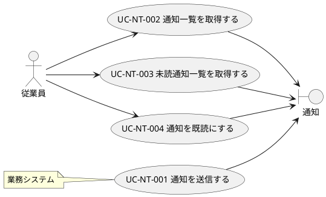

# NT-01 通知管理 UC複合図

## ユースケース複合図

## ユースケース一覧

| UC ID     | UC名                   | 関連アクター | 関連情報 |
|-----------|------------------------|--------------|----------|
| UC-NT-001 | 通知を送信する         | 業務システム | 通知     |
| UC-NT-002 | 通知一覧を取得する     | 従業員       | 通知     |
| UC-NT-003 | 未読通知一覧を取得する | 従業員       | 通知     |
| UC-NT-004 | 通知を既読にする       | 従業員       | 通知     |
