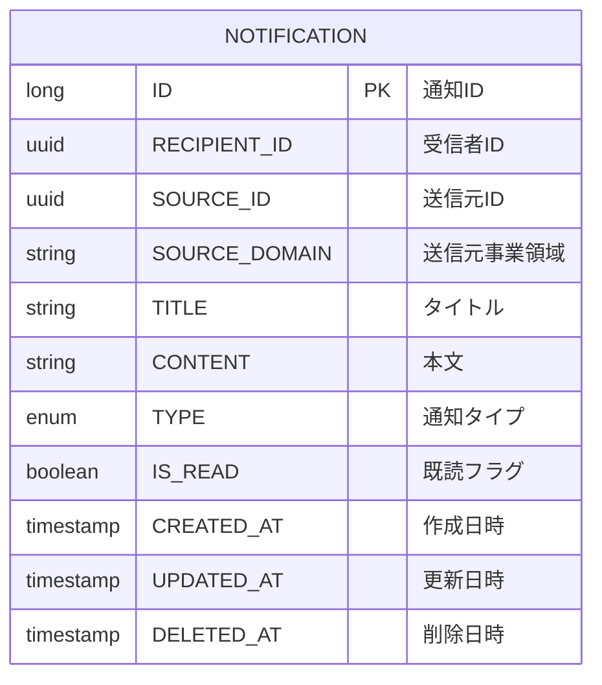

# 論理データモデル

## 概要

NT-01 通知管理業務領域の論理データモデルをMermaid ER図で表現します。

## ER図

## 論理データ一覧

| データ名 | 項目名 | タイプ | isKey | 説明 |
|----------|--------|--------|-------|------|
| 通知 | ID | long | true | 通知ID（Snowflake ID） |
| 通知 | RECIPIENT_ID | uuid | false | 受信者ID（従業員ID） |
| 通知 | SOURCE_ID | uuid | false | 送信元ID |
| 通知 | SOURCE_DOMAIN | string | false | 送信元事業領域 |
| 通知 | TITLE | string | false | タイトル |
| 通知 | CONTENT | string | false | 本文 |
| 通知 | TYPE | enum | false | 通知タイプ |
| 通知 | IS_READ | boolean | false | 既読フラグ |
| 通知 | CREATED_AT | timestamp | false | 作成日時 |
| 通知 | UPDATED_AT | timestamp | false | 更新日時 |
| 通知 | DELETED_AT | timestamp | false | 削除日時 |
