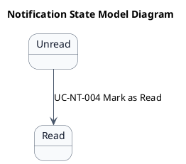
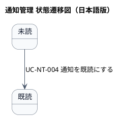

# NT-01 通知管理 ステートマシン図

## 1. 目的

本書は、NT-01 通知管理業務領域のシステムレイヤーで扱う情報の状態遷移を示す状態モデル図（ステートマシン図）です。

## 2. PlantUML 状態遷移図（英語版）

## 3. 日本語版 状態遷移図

## 4. 状態一覧

| 状態名 (ID)       | 英語名    | 説明 |
|-------------------|-----------|------|
| 未読 (ST-NT-001) | Unread | 通知が作成された状態（デフォルト） |
| 既読 (ST-NT-002) | Read | 通知が確認された状態 |

## 5. 遷移一覧

| 遷移ID | 元状態       | 遷移先状態 | トリガー  | 関連ユースケース | 説明 |
|--------|--------------|------------|-----------|------------------|------|
| TR-01  | Unread | Read | 既読マーク | UC-NT-004         | 通知を既読にする |

## 6. 参照情報

- ステート一覧: `02.ステート/ステート一覧.tsv`
- 関連ユースケース: `03.システム境界/UC複合図.md`
