# EF_電子帳票 データベース設計

## 1. 概要

電子帳票事業領域のデータベース設計を定義します。EF_電子帳票は、帳票の生成・管理・配信・保管・アーカイブ・監査を一元的に管理するシステムです。

## 2. 参照

- 事業領域一覧: `docs/11 事業領域/事業領域一覧.tsv`
- 業務領域一覧: `docs/12 業務領域/業務領域一覧.tsv`
- 情報一覧: `docs/22 要件定義書/EF 電子帳票/03 機能要件/*/04.システム/01.情報/情報一覧.md`
- 情報属性一覧: `docs/22 要件定義書/EF 電子帳票/03 機能要件/*/04.システム/01.情報/02.属性/INF-EF-*_情報属性一覧.md`

## 3. テーブル一覧

EF_電子帳票は29のテーブルで構成されます。

### 3.1 EF-01 帳票基盤管理 (9テーブル)

| No. | テーブル名 | 説明 | 情報番号 |
|-----|-----------|------|---------|
| 1 | `environment` | システム利用環境 | INF-EF-01 |
| 2 | `business_system` | 業務システム | INF-EF-02 |
| 3 | `storage_connection` | ストレージ接続 | INF-EF-03 |
| 4 | `access_control_policy` | アクセス制御ポリシー | INF-EF-04 |
| 5 | `organization` | 組織 | INF-EF-05 |
| 6 | `user_account` | 利用者 | INF-EF-06 |
| 7 | `role` | ロール | INF-EF-07 |
| 8 | `external_api_key` | 外部APIキー | INF-EF-08 |
| 9 | `system_setting` | システム設定 | INF-EF-09 |

### 3.2 EF-02 帳票管理 (5テーブル)

| No. | テーブル名 | 説明 | 情報番号 |
|-----|-----------|------|---------|
| 10 | `form_definition` | 帳票定義 | INF-EF-10 |
| 11 | `form_template` | 帳票テンプレート | INF-EF-11 |
| 12 | `form_generation_setting` | 帳票生成設定 | INF-EF-12 |
| 13 | `form_document` | 帳票情報 | INF-EF-13 |
| 14 | `form_version` | 帳票バージョン | INF-EF-14 |

### 3.3 EF-03 帳票利用 (4テーブル)

| No. | テーブル名 | 説明 | 情報番号 |
|-----|-----------|------|---------|
| 15 | `form_delivery` | 帳票配信 | INF-EF-15 |
| 16 | `form_preview` | 帳票プレビュー | INF-EF-16 |
| 17 | `form_search` | 帳票検索 | INF-EF-17 |
| 18 | `form_approval` | 承認・確認 | INF-EF-18 |

### 3.4 EF-04 保管・アーカイブ (6テーブル)

| No. | テーブル名 | 説明 | 情報番号 |
|-----|-----------|------|---------|
| 19 | `retention_period` | 保存期間 | INF-EF-19 |
| 20 | `disposal` | 廃棄 | INF-EF-20 |
| 21 | `archive_policy` | アーカイブポリシー | INF-EF-21 |
| 22 | `archive_target` | アーカイブ対象 | INF-EF-22 |
| 23 | `archive_process` | アーカイブ処理 | INF-EF-23 |
| 24 | `form_restore` | 帳票自動復元 | INF-EF-24 |

### 3.5 EF-05 運用・監査 (5テーブル)

| No. | テーブル名 | 説明 | 情報番号 |
|-----|-----------|------|---------|
| 25 | `notification_setting` | 通知設定 | INF-EF-25 |
| 26 | `audit_log` | 監査ログ | INF-EF-26 |
| 27 | `operation_management` | 運用管理 | INF-EF-27 |
| 28 | `form_analysis` | 帳票分析 | INF-EF-28 |
| 29 | `archive_operation` | アーカイブ運用 | INF-EF-29 |

## 4. テーブルカラム定義

各テーブルの詳細なカラム定義は[02 テーブルカラム定義](02%20テーブルカラム定義/index.md)を参照してください。

## 5. Viewカラム定義

Viewの詳細なカラム定義は[03 viewカラム定義](03%20viewカラム定義/index.md)を参照してください。

## 6. ER図

```mermaid
erDiagram
    environment {
        string environment_id PK "システム利用環境ID"
        string tenant_id "テナントID"
        string system_name "システム名"
        string environment_type "環境区分"
        text description "説明"
        string status "状態"
        datetime created_at "作成日時"
        datetime updated_at "更新日時"
    }

    business_system {
        string system_id PK "業務システムID"
        string system_name "システム名"
        string system_type "システム種類"
        text connection_config "接続設定"
        string api_endpoint "APIエンドポイント"
        string status "状態"
        text description "説明"
        datetime created_at "作成日時"
        datetime updated_at "更新日時"
    }

    storage_connection {
        string storage_id PK "ストレージID"
        string storage_name "ストレージ名"
        string storage_type "ストレージ種類"
        string endpoint_url "エンドポイントURL"
        string bucket_name "バケット名"
        string access_key "アクセスキー"
        string secret_key "シークレットキー"
        string region "リージョン"
        string status "状態"
        text description "説明"
        datetime created_at "作成日時"
        datetime updated_at "更新日時"
    }

    access_control_policy {
        string policy_id PK "ポリシーID"
        string system_id FK "業務システムID"
        string policy_name "ポリシー名"
        string policy_type "ポリシー種類"
        text access_rule "アクセスルール"
        string scope "適用範囲"
        string status "状態"
        text description "説明"
        datetime created_at "作成日時"
        datetime updated_at "更新日時"
    }

    organization {
        string org_id PK "組織ID"
        string org_name "組織名"
        string parent_org_id FK "親組織ID"
        string org_type "組織種類"
        string org_code "組織コード"
        string status "状態"
        text description "説明"
        datetime created_at "作成日時"
        datetime updated_at "更新日時"
    }

    user_account {
        string user_id PK "利用者ID"
        string login_id "ログインID"
        string user_name "氏名"
        string email "メールアドレス"
        string org_id FK "所属組織ID"
        string password_hash "パスワードハッシュ"
        string status "状態"
        datetime last_login_at "最終ログイン日時"
        datetime created_at "作成日時"
        datetime updated_at "更新日時"
    }

    role {
        string role_id PK "ロールID"
        string role_name "ロール名"
        string role_type "ロール種類"
        text permission_set "権限セット"
        string status "状態"
        text description "説明"
        datetime created_at "作成日時"
        datetime updated_at "更新日時"
    }

    external_api_key {
        string api_key_id PK "APIキーID"
        string system_id FK "業務システムID"
        string api_key_name "APIキー名"
        string api_key "APIキー"
        string api_secret "APIシークレット"
        string api_endpoint "APIエンドポイント"
        string status "状態"
        datetime expires_at "有効期限"
        datetime last_used_at "最終利用日時"
        text description "説明"
        datetime created_at "作成日時"
        datetime updated_at "更新日時"
    }

    system_setting {
        string setting_id PK "設定ID"
        string setting_key "設定キー"
        text setting_value "設定値"
        string category "カテゴリ"
        string data_type "データ型"
        string scope "適用範囲"
        string status "状態"
        text description "説明"
        datetime created_at "作成日時"
        datetime updated_at "更新日時"
    }

    form_definition {
        string form_def_id PK "帳票定義ID"
        string form_type "帳票種類"
        string form_name "帳票名"
        string system_id FK "業務システムID"
        text layout_config "レイアウト設定"
        string paper_size "用紙サイズ"
        string orientation "印刷方向"
        string status "状態"
        text description "説明"
        datetime created_at "作成日時"
        datetime updated_at "更新日時"
    }

    form_template {
        string template_id PK "テンプレートID"
        string form_def_id FK "帳票定義ID"
        string template_name "テンプレート名"
        string template_file_path "テンプレートファイルパス"
        string file_format "ファイル形式"
        string version "バージョン"
        long file_size "ファイルサイズ"
        string status "状態"
        text description "説明"
        datetime created_at "作成日時"
        datetime updated_at "更新日時"
    }

    form_generation_setting {
        string setting_id PK "生成設定ID"
        string form_def_id FK "帳票定義ID"
        string output_format "出力形式"
        string destination_type "宛先種類"
        text destination_config "宛先設定"
        boolean auto_generate "自動生成フラグ"
        string status "状態"
        text description "説明"
        datetime created_at "作成日時"
        datetime updated_at "更新日時"
    }

    form_document {
        string form_id PK "帳票ID"
        string form_def_id FK "帳票定義ID"
        string system_id FK "業務システムID"
        string form_title "帳票タイトル"
        string creator_id FK "作成者ID"
        string storage_path "ストレージパス"
        long file_size "ファイルサイズ"
        string file_format "ファイル形式"
        string status "状態"
        text description "説明"
        datetime created_at "作成日時"
        datetime updated_at "更新日時"
    }

    form_version {
        string version_id PK "バージョンID"
        string form_id FK "帳票ID"
        integer version_number "バージョン番号"
        text change_description "変更内容"
        string changed_by FK "変更者ID"
        string storage_path "ストレージパス"
        long file_size "ファイルサイズ"
        boolean is_current "現在有効フラグ"
        datetime created_at "作成日時"
    }

    form_delivery {
        string delivery_id PK "配信ID"
        string form_id FK "帳票ID"
        string recipient_id FK "配信先利用者ID"
        string delivery_type "配信種類"
        string delivery_status "配信状態"
        datetime delivered_at "配信完了日時"
        text error_message "エラーメッセージ"
        datetime created_at "作成日時"
        datetime updated_at "更新日時"
    }

    form_preview {
        string preview_id PK "プレビューID"
        string form_id FK "帳票ID"
        string user_id FK "利用者ID"
        string preview_url "プレビューURL"
        integer view_count "閲覧回数"
        datetime last_viewed_at "最終閲覧日時"
        datetime created_at "作成日時"
        datetime updated_at "更新日時"
    }

    form_search {
        string search_id PK "検索ID"
        string user_id FK "利用者ID"
        text search_keywords "検索キーワード"
        text search_filters "検索フィルター"
        integer result_count "検索結果件数"
        datetime executed_at "検索実行日時"
    }

    form_approval {
        string approval_id PK "承認ID"
        string form_id FK "帳票ID"
        string approver_id FK "承認者ID"
        string approval_type "承認種類"
        string approval_status "承認状態"
        text approval_comment "承認コメント"
        datetime approved_at "承認日時"
        datetime created_at "作成日時"
        datetime updated_at "更新日時"
    }

    retention_period {
        string retention_id PK "保存期間ID"
        string form_def_id FK "帳票定義ID"
        integer retention_period "保存期間"
        string retention_unit "期間単位"
        string retention_policy "保存ポリシー"
        string status "状態"
        text description "説明"
        datetime created_at "作成日時"
        datetime updated_at "更新日時"
    }

    disposal {
        string disposal_id PK "廃棄ID"
        string form_id FK "帳票ID"
        string disposal_reason "廃棄理由"
        string disposal_status "廃棄状態"
        string disposed_by FK "廃棄実行者ID"
        datetime disposed_at "廃棄実行日時"
        datetime scheduled_at "廃棄予定日時"
        text description "説明"
        datetime created_at "作成日時"
        datetime updated_at "更新日時"
    }

    archive_policy {
        string archive_policy_id PK "アーカイブポリシーID"
        string policy_name "ポリシー名"
        string form_def_id FK "帳票定義ID"
        string archive_trigger "アーカイブトリガー"
        string archive_destination "アーカイブ先"
        string compression_type "圧縮種類"
        string status "状態"
        text description "説明"
        datetime created_at "作成日時"
        datetime updated_at "更新日時"
    }

    archive_target {
        string archive_target_id PK "アーカイブ対象ID"
        string form_id FK "帳票ID"
        string archive_policy_id FK "アーカイブポリシーID"
        string target_status "対象状態"
        string original_path "元のストレージパス"
        string archive_path "アーカイブ先パス"
        datetime scheduled_at "アーカイブ予定日時"
        datetime archived_at "アーカイブ実行日時"
        datetime created_at "作成日時"
        datetime updated_at "更新日時"
    }

    archive_process {
        string archive_process_id PK "アーカイブ処理ID"
        string archive_policy_id FK "アーカイブポリシーID"
        string process_type "処理種類"
        string process_status "処理状態"
        integer target_count "対象件数"
        integer processed_count "処理済み件数"
        text error_message "エラーメッセージ"
        datetime started_at "処理開始日時"
        datetime completed_at "処理完了日時"
        datetime created_at "作成日時"
        datetime updated_at "更新日時"
    }

    form_restore {
        string restore_id PK "復元ID"
        string form_id FK "帳票ID"
        string user_id FK "利用者ID"
        string restore_status "復元状態"
        string archive_path "アーカイブ元パス"
        string restore_path "復元先パス"
        text error_message "エラーメッセージ"
        datetime requested_at "復元要求日時"
        datetime completed_at "復元完了日時"
        datetime created_at "作成日時"
        datetime updated_at "更新日時"
    }

    notification_setting {
        string notification_id PK "通知設定ID"
        string user_id FK "利用者ID"
        string notification_type "通知種類"
        string event_type "通知イベント種類"
        boolean enabled "通知有効フラグ"
        string status "状態"
        text description "説明"
        datetime created_at "作成日時"
        datetime updated_at "更新日時"
    }

    audit_log {
        string audit_log_id PK "監査ログID"
        string user_id FK "利用者ID"
        string action_type "操作種類"
        string target_type "操作対象種類"
        string target_id FK "操作対象ID"
        text action_detail "操作詳細"
        string ip_address "IPアドレス"
        string user_agent "ユーザーエージェント"
        datetime executed_at "操作実行日時"
    }

    operation_management {
        string operation_id PK "運用管理ID"
        string operation_type "運用種類"
        string operation_name "運用名"
        string status "状態"
        text error_message "エラーメッセージ"
        string resolved_by FK "解決者ID"
        datetime resolved_at "解決日時"
        text description "説明"
        datetime created_at "作成日時"
        datetime updated_at "更新日時"
    }

    form_analysis {
        string analysis_id PK "分析ID"
        string analysis_type "分析種類"
        string analysis_period "分析期間"
        date start_date "分析開始日"
        date end_date "分析終了日"
        text result_data "分析結果データ"
        string status "状態"
        datetime executed_at "分析実行日時"
        datetime created_at "作成日時"
        datetime updated_at "更新日時"
    }

    archive_operation {
        string archive_ops_id PK "アーカイブ運用ID"
        string operation_type "運用種類"
        string operation_name "運用名"
        string status "状態"
        integer archive_count "アーカイブ件数"
        integer restore_count "復元件数"
        text error_message "エラーメッセージ"
        text description "説明"
        datetime created_at "作成日時"
        datetime updated_at "更新日時"
    }

    business_system ||--o{ access_control_policy : "has"
    business_system ||--o{ external_api_key : "has"
    business_system ||--o{ form_definition : "has"
    organization ||--o{ user_account : "has"
    form_definition ||--o{ form_template : "has"
    form_definition ||--o{ form_generation_setting : "has"
    form_definition ||--o{ retention_period : "has"
    form_document ||--o{ form_version : "has"
    form_document ||--o{ form_delivery : "has"
    form_document ||--o{ form_preview : "has"
    form_document ||--o{ form_approval : "has"
    form_document ||--o{ disposal : "has"
    form_document ||--o{ archive_target : "has"
    form_document ||--o{ form_restore : "has"
    archive_policy ||--o{ archive_target : "has"
    archive_policy ||--o{ archive_process : "has"
```

