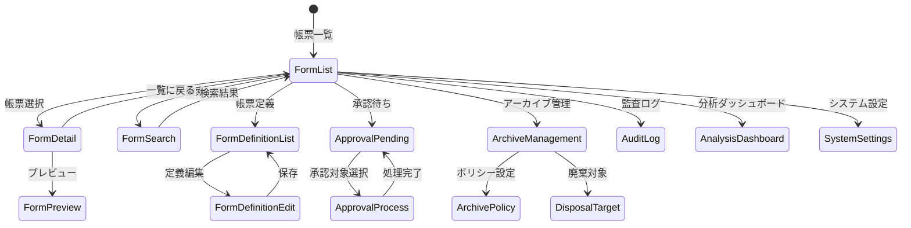

# EF_電子帳票 フロントエンド詳細設計

## 1. 概要

本ドキュメントは、EF_電子帳票事業領域のフロントエンド詳細設計を定義します。React + TypeScript + Material UI を基盤とし、帳票の生成・管理・配信・保管・アーカイブ・監査を一元的に管理するUIを設計します。

## 2. 参照

- 事業領域一覧: `docs/11 事業領域/事業領域一覧.tsv`
- 業務領域一覧: `docs/12 業務領域/業務領域一覧.tsv`
- 画面属性一覧: `docs/22 要件定義書/EF 電子帳票/03 機能要件/*/04.システム/04.画面/SCR-*_画面属性一覧.md`
- API設計: `docs/23 詳細設計書/EF_電子帳票/backend/api/index.md`

## 3. 技術スタック

| カテゴリ | テクノロジー |
|:---|:---|
| **フレームワーク** | React 18 + TypeScript |
| **UIコンポーネント** | MUI (Material UI) v5 |
| **ルーティング** | React Router v6 |
| **ステート管理** | Zustand |
| **API通信** | Axios |
| **フォーム** | React Hook Form + Zod |
| **PDFプレビュー** | react-pdf |
| **チャート** | Recharts |

## 4. ページコンポーネント一覧

EF_電子帳票は16の画面で構成されます。

| 画面ID | 画面名 | ルートパス | 業務領域 | 対応UC |
|--------|--------|-----------|---------|--------|
| SCR-001 | 帳票配信画面 | `/ef/deliveries` | EF-03 帳票利用 | UC-EF-035〜037 |
| SCR-002 | 帳票一覧画面 | `/ef/forms` | EF-02 帳票管理 | UC-EF-030〜033 |
| SCR-003 | 帳票詳細・プレビュー画面 | `/ef/forms/:id` | EF-02/EF-03 | UC-EF-028, UC-EF-038〜042 |
| SCR-004 | 帳票検索画面 | `/ef/search` | EF-03 帳票利用 | UC-EF-043〜044 |
| SCR-005 | 承認待ち一覧画面 | `/ef/approvals/pending` | EF-03 帳票利用 | UC-EF-046 |
| SCR-006 | 承認処理画面 | `/ef/approvals/:id` | EF-03 帳票利用 | UC-EF-047〜049 |
| SCR-007 | 帳票定義一覧画面 | `/ef/definitions` | EF-02 帳票管理 | UC-EF-026 |
| SCR-008 | 帳票定義編集画面 | `/ef/definitions/:id` | EF-02 帳票管理 | UC-EF-024〜025 |
| SCR-009 | システム設定画面 | `/ef/settings` | EF-01 帳票基盤管理 | UC-EF-001〜023 |
| SCR-010 | アーカイブ管理画面 | `/ef/archives` | EF-04 保管・アーカイブ | UC-EF-060〜062, UC-EF-078 |
| SCR-011 | アーカイブポリシー画面 | `/ef/archive-policies` | EF-04 保管・アーカイブ | UC-EF-054〜056 |
| SCR-012 | 廃棄・アーカイブ対象画面 | `/ef/disposals` | EF-04 保管・アーカイブ | UC-EF-051〜059 |
| SCR-013 | 復元管理画面 | `/ef/restores` | EF-04 保管・アーカイブ | UC-EF-063〜065 |
| SCR-014 | 運用エラー画面 | `/ef/operations/errors` | EF-05 運用・監査 | UC-EF-073〜074, UC-EF-079〜080 |
| SCR-015 | 監査ログ画面 | `/ef/audit-logs` | EF-05 運用・監査 | UC-EF-069〜071 |
| SCR-016 | 分析ダッシュボード | `/ef/analysis` | EF-05 運用・監査 | UC-EF-075〜077 |

## 5. ルーティング設計

```typescript
// ルート構成
const routes = [
  {
    path: '/ef',
    element: <EFLayout />,
    children: [
      // 帳票管理
      { path: 'forms', element: <FormListPage /> },
      { path: 'forms/:id', element: <FormDetailPage /> },
      { path: 'definitions', element: <FormDefinitionListPage /> },
      { path: 'definitions/:id', element: <FormDefinitionEditPage /> },
      // 帳票利用
      { path: 'search', element: <FormSearchPage /> },
      { path: 'deliveries', element: <FormDeliveryPage /> },
      { path: 'approvals/pending', element: <ApprovalPendingPage /> },
      { path: 'approvals/:id', element: <ApprovalProcessPage /> },
      // 保管・アーカイブ
      { path: 'archives', element: <ArchiveManagementPage /> },
      { path: 'archive-policies', element: <ArchivePolicyPage /> },
      { path: 'disposals', element: <DisposalTargetPage /> },
      { path: 'restores', element: <RestoreManagementPage /> },
      // 運用・監査
      { path: 'operations/errors', element: <OperationErrorPage /> },
      { path: 'audit-logs', element: <AuditLogPage /> },
      { path: 'analysis', element: <AnalysisDashboardPage /> },
      // システム設定
      { path: 'settings', element: <SystemSettingsPage /> },
    ],
  },
];
```

## 6. 型定義

### 6.1 帳票関連型

```typescript
// 帳票定義
interface FormDefinition {
  formDefId: string;
  formType: string;
  formName: string;
  systemId: string;
  layoutConfig?: string;
  paperSize?: string;
  orientation?: string;
  status: string;
  description?: string;
  createdAt: string;
  updatedAt: string;
}

// 帳票ドキュメント
interface FormDocument {
  formId: string;
  formDefId: string;
  systemId: string;
  formTitle: string;
  creatorId: string;
  storagePath: string;
  fileSize?: number;
  fileFormat: string;
  status: string;
  description?: string;
  createdAt: string;
  updatedAt: string;
}

// 帳票バージョン
interface FormVersion {
  versionId: string;
  formId: string;
  versionNumber: number;
  changeDescription?: string;
  changedBy: string;
  storagePath: string;
  fileSize?: number;
  isCurrent: boolean;
  createdAt: string;
}
```

### 6.2 帳票利用関連型

```typescript
// 帳票配信
interface FormDelivery {
  deliveryId: string;
  formId: string;
  recipientId: string;
  deliveryType: string;
  deliveryStatus: string;
  deliveredAt?: string;
  errorMessage?: string;
  createdAt: string;
  updatedAt: string;
}

// 帳票承認
interface FormApproval {
  approvalId: string;
  formId: string;
  approverId: string;
  approvalType: string;
  approvalStatus: string;
  approvalComment?: string;
  approvedAt?: string;
  createdAt: string;
  updatedAt: string;
}

// 監査ログ
interface AuditLog {
  auditLogId: string;
  userId: string;
  actionType: string;
  targetType: string;
  targetId: string;
  actionDetail?: string;
  ipAddress?: string;
  userAgent?: string;
  executedAt: string;
}
```

### 6.3 アーカイブ関連型

```typescript
// アーカイブポリシー
interface ArchivePolicy {
  archivePolicyId: string;
  policyName: string;
  formDefId?: string;
  archiveTrigger: string;
  archiveDestination: string;
  compressionType?: string;
  status: string;
  description?: string;
  createdAt: string;
  updatedAt: string;
}

// アーカイブ処理
interface ArchiveProcess {
  archiveProcessId: string;
  archivePolicyId: string;
  processType: string;
  processStatus: string;
  targetCount: number;
  processedCount: number;
  errorMessage?: string;
  startedAt?: string;
  completedAt?: string;
  createdAt: string;
  updatedAt: string;
}
```

## 7. ステート管理設計

### 7.1 Zustandストア

```typescript
// 帳票ストア
interface FormStore {
  forms: FormDocument[];
  currentForm: FormDocument | null;
  loading: boolean;
  error: string | null;
  fetchForms: (params: FormSearchParams) => Promise<void>;
  fetchForm: (formId: string) => Promise<void>;
  generateForm: (command: CreateFormCommand) => Promise<void>;
  updateForm: (formId: string, command: UpdateFormCommand) => Promise<void>;
}

// 承認ストア
interface ApprovalStore {
  pendingApprovals: FormApproval[];
  loading: boolean;
  fetchPendingApprovals: () => Promise<void>;
  approveForm: (approvalId: string, comment?: string) => Promise<void>;
  rejectForm: (approvalId: string, comment: string) => Promise<void>;
  returnForm: (approvalId: string, comment: string) => Promise<void>;
}

// アーカイブストア
interface ArchiveStore {
  archiveProcesses: ArchiveProcess[];
  archivePolicies: ArchivePolicy[];
  loading: boolean;
  fetchArchiveProcesses: () => Promise<void>;
  fetchArchivePolicies: () => Promise<void>;
  executeArchive: (policyId: string) => Promise<void>;
}
```

## 8. API連携設計

### 8.1 APIクライアント

```typescript
// APIベースURL
const API_BASE_URL = '/api/v1';

// 帳票API
const formApi = {
  listForms: (params: FormSearchParams) =>
    axios.get<PageResponse<FormDocument>>(`${API_BASE_URL}/form-documents`, { params }),
  getForm: (formId: string) =>
    axios.get<FormDocument>(`${API_BASE_URL}/form-documents/${formId}`),
  generateForm: (command: CreateFormCommand) =>
    axios.post<string>(`${API_BASE_URL}/form-documents`, command),
  downloadForm: (formId: string) =>
    axios.get(`${API_BASE_URL}/form-documents/${formId}/download`, { responseType: 'blob' }),
  previewForm: (formId: string) =>
    axios.get<string>(`${API_BASE_URL}/form-documents/${formId}/preview`),
};

// 承認API
const approvalApi = {
  listPending: () =>
    axios.get<FormApproval[]>(`${API_BASE_URL}/form-approvals/pending`),
  approve: (approvalId: string, command: ApproveFormCommand) =>
    axios.patch(`${API_BASE_URL}/form-approvals/${approvalId}/approve`, command),
  reject: (approvalId: string, command: RejectFormCommand) =>
    axios.patch(`${API_BASE_URL}/form-approvals/${approvalId}/reject`, command),
};

// アーカイブAPI
const archiveApi = {
  listProcesses: () =>
    axios.get<ArchiveProcess[]>(`${API_BASE_URL}/archive-processes`),
  executeArchive: (policyId: string) =>
    axios.post<string>(`${API_BASE_URL}/archive-processes`, { archivePolicyId: policyId }),
};
```

## 9. UIコンポーネント設計

### 9.1 共有コンポーネント

| コンポーネント | 説明 | MUIコンポーネント |
|---------------|------|------------------|
| `FormTable` | 帳票一覧テーブル | DataGrid |
| `FormSearchForm` | 帳票検索フォーム | TextField + Autocomplete |
| `FormPreview` | 帳票プレビュー | react-pdf Viewer |
| `ApprovalDialog` | 承認・差戻し・却下ダイアログ | Dialog + TextField |
| `StatusBadge` | 状態バッジ | Chip |
| `ArchiveProgress` | アーカイブ進捗バー | LinearProgress |
| `AuditLogTable` | 監査ログテーブル | DataGrid |
| `SettingsTab` | 設定タブパネル | Tab + TabPanel |

### 9.2 MUIテーマカスタマイゼーション

```typescript
const theme = createTheme({
  palette: {
    primary: { main: '#1976d2' },
    secondary: { main: '#dc004e' },
    status: {
      success: '#4caf50',
      warning: '#ff9800',
      error: '#f44336',
      info: '#2196f3',
    },
  },
  components: {
    MuiDataGrid: {
      styleOverrides: {
        root: { border: '1px solid #e0e0e0' },
      },
    },
  },
});
```

## 10. 画面イメージ

### 10.1 帳票一覧画面 (SCR-002)

```
┌─────────────────────────────────────────────────────────────────┐
│  帳票一覧                                              [検索]  │
├─────────────────────────────────────────────────────────────────┤
│                                                                 │
│  ┌─ フィルター ─────────────────────────────────────────────┐   │
│  │ 帳票種類: [▼]  状態: [▼]  作成日: [  ] ~ [  ]  [検索]   │   │
│  └──────────────────────────────────────────────────────────┘   │
│                                                                 │
│  ┌── 帳票一覧テーブル ──────────────────────────────────────┐   │
│  │ □ | 帳票タイトル | 種類 | 状態 | 作成日 | 作成者 | 操作 │   │
│  │---|-------------|------|------|--------|--------|------│   │
│  │ □ | 請求書_001  | 請求書 | 送信済み | 2024-01-15 | 田中 | ...│   │
│  │ □ | 納品書_002  | 納品書 | 承認待ち | 2024-01-16 | 鈴木 | ...│   │
│  │ □ | 発注書_003  | 発注書 | 生成済み | 2024-01-17 | 高橋 | ...│   │
│  └──────────────────────────────────────────────────────────┘   │
│                                                                 │
│  [1] [2] [3] ... [10]  (1-20 / 200件)                          │
└─────────────────────────────────────────────────────────────────┘
```

### 10.2 帳票プレビュー画面 (SCR-003)

```
┌─────────────────────────────────────────────────────────────────┐
│  帳票詳細: 請求書_001                              [← 一覧に戻る]│
├─────────────────────────────────────────────────────────────────┤
│  ┌─ 帳票情報 ──────────────────────────────────────────────┐   │
│  │ 種類: 請求書  状態: [送信済み]  作成日: 2024-01-15      │   │
│  │ 作成者: 田中太郎  ファイルサイズ: 2.5MB                 │   │
│  └──────────────────────────────────────────────────────────┘   │
│                                                                 │
│  ┌─ プレビュー ───────────────────────────────────────────┐   │
│  │                                                        │   │
│  │   ┌──────────────────────────────────────┐             │   │
│  │   │         PDFプレビュー領域            │             │   │
│  │   │                                      │             │   │
│  │   │         (react-pdf Viewer)           │             │   │
│  │   │                                      │             │   │
│  │   └──────────────────────────────────────┘             │   │
│  │                                                        │   │
│  │  [← 前ページ]  1 / 5  [次ページ →]  [-] [+]           │   │
│  └──────────────────────────────────────────────────────────┘   │
│                                                                 │
│  [ダウンロード]  [印刷]  [バージョン履歴]                       │
└─────────────────────────────────────────────────────────────────┘
```

### 10.3 分析ダッシュボード (SCR-016)

```
┌─────────────────────────────────────────────────────────────────┐
│  帳票分析ダッシュボード                                        │
├─────────────────────────────────────────────────────────────────┤
│  ┌─ 集計期間 ───────────────────────────────────────────────┐   │
│  │ [2024-01-01] ~ [2024-01-31]  [月次 ▼]  [更新]           │   │
│  └──────────────────────────────────────────────────────────┘   │
│                                                                 │
│  ┌─ 帳票生成件数 ───────────────────────────────────────────┐   │
│  │  ┌──────────────────────────────────────────┐            │   │
│  │  │  ████████                                │            │   │
│  │  │  ████████████  (Recharts BarChart)       │            │   │
│  │  │  ████████████████                       │            │   │
│  │  └──────────────────────────────────────────┘            │   │
│  │  合計: 1,234件                                           │   │
│  └──────────────────────────────────────────────────────────┘   │
│                                                                 │
│  ┌─ 配信状況 ───────────────────────────────────────────────┐   │
│  │  送信済み: 980件 (79%)  送信中: 50件 (4%)  失敗: 204件   │   │
│  │  ████████████████████████████░░░░░░░░░░░░░░              │   │
│  └──────────────────────────────────────────────────────────┘   │
│                                                                 │
│  ┌─ ストレージ使用量 ───────────────────────────────────────┐   │
│  │  通常: 150GB  アーカイブ: 500GB  プレビュー: 10GB       │   │
│  │  ┌──────────────────────────────────────────┐            │   │
│  │  │  (Recharts PieChart)                     │            │   │
│  │  └──────────────────────────────────────────┘            │   │
│  └──────────────────────────────────────────────────────────┘   │
└─────────────────────────────────────────────────────────────────┘
```

## 11. 画面遷移図



## 12. アクセシビリティ対応

| 項目 | 対応内容 |
|------|---------|
| **キーボード操作** | Tabキーでのフォーカス移動、Enter/Spaceでのボタン操作 |
| **スクリーンリーダー** | ARIAラベル付与、見出し階層の適切な構成 |
| **カラーコントラスト** | WCAG 2.1 AA基準以上のコントラスト比 |
| **フォーカスインジケーター** | 明確なフォーカス枠の表示 |
| **フォームラベル** | 全入力フィールドにラベル关联 |
| **エラーメッセージ** | aria-invalid, aria-describedby でエラー通知 |

## 13. 権限・表示制御設計

| 権限 | 説明 | 対応ロール |
|------|------|-----------|
| `ef:form:read` | 帳票の閲覧 | 全利用者 |
| `ef:form:write` | 帳票の生成・更新 | 帳票管理者 |
| `ef:form:approve` | 帳票の承認 | 承認者 |
| `ef:form:delete` | 帳票の削除 | システム管理者 |
| `ef:definition:manage` | 帳票定義の管理 | システム管理者 |
| `ef:archive:manage` | アーカイブ管理 | アーカイブ管理者 |
| `ef:audit:view` | 監査ログの閲覧 | 監査担当者 |
| `ef:system:manage` | システム設定の管理 | システム管理者 |

## 14. 出力チェック

- [ ] 全16画面のページコンポーネントを定義
- [ ] ルーティング設計を記載
- [ ] 型定義を記載
- [ ] ステート管理設計を記載
- [ ] API連携設計を記載
- [ ] UIコンポーネント一覧を記載
- [ ] 画面イメージ（ASCII ワイヤーフレーム）を記載
- [ ] 画面遷移図（Mermaid）を記載
- [ ] アクセシビリティ対応を記載
- [ ] 権限・表示制御を記載
