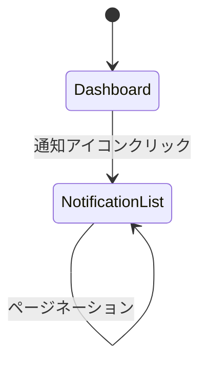

# NT_通知 フロントエンド詳細設計

## 概要

通知事業領域のフロントエンド詳細設計資材を格納します。

## 参照

- 事業領域一覧: `docs/11 事業領域/事業領域一覧.tsv`
- 業務領域一覧: `docs/12 業務領域/業務領域一覧.tsv`
- 画面一覧: `docs/22 要件定義書/NT 通知/03 機能要件/NT-01 通知管理/04.システム/04.画面/画面一覧.json`
- 画面属性一覧: `docs/22 要件定義書/NT 通知/03 機能要件/NT-01 通知管理/04.システム/04.画面/SCR-NT-001_画面属性一覧.md`

---

# SCR-NT-001 通知一覧画面 画面設計

## 1. 画面概要

| 項目 | 値 |
|------|-----|
| 画面ID | SCR-NT-001 |
| 画面名 | 通知一覧画面 |
| 説明 | 通知の一覧を表示し、既読マークを行う画面 |
| 関連ユースケース | UC-NT-002, UC-NT-003, UC-NT-004 |
| 対応ページコンポーネント | `src/pages/notification/NotificationList.tsx` |

## 2. ルーティング

| 項目 | 値 |
|------|-----|
| パス | `/notifications` |
| クエリパラメータ | `status` (unread/all) - 未読通知のみを表示するか全通知を表示するか |

## 3. 画面イメージ

```
┌─────────────────────────────────────────────────────────────────────┐
│  通知一覧                                                          │
├─────────────────────────────────────────────────────────────────────┤
│  [○ 未読のみ] [● すべて]                                          │
├─────────────────────────────────────────────────────────────────────┤
│  ┌───────────────────────────────────────────────────────────────┐  │
│  │ ┌───────────────────────────────────────────────────────────┐ │  │
│  │ │ ● メンション通知          MENTION    2024/01/15 10:30    │ │  │
│  │ ├───────────────────────────────────────────────────────────┤ │  │
│  │ │   担当者変更通知          ASSIGNEE_CHANGE  2024/01/15 09:15│ │  │
│  │ │    [既読ボタン]                                      │ │  │
│  │ ├───────────────────────────────────────────────────────────┤ │  │
│  │ │   期限通知                DUE_DATE     2024/01/14 18:00  │ │  │
│  │ │    [既読ボタン]                                      │ │  │
│  │ ├───────────────────────────────────────────────────────────┤ │  │
│  │ │   ...                                                 │ │  │
│  │ └───────────────────────────────────────────────────────────┘ │  │
│  │                                                               │  │
│  │  < 1  2  3 ... >  (ページネーション)                          │  │
│  └───────────────────────────────────────────────────────────────┘  │
├─────────────────────────────────────────────────────────────────────┤
│  ┌───────────────────────────────────────────────────────────────┐  │
│  │  通知詳細                                                     │  │
│  │                                                               │  │
│  │  タイトル: メンション通知                                     │  │
│  │  本文: あなたはメンションされました                           │  │
│  │  通知タイプ: MENTION                                          │  │
│  │  送信元事業領域: AG アジルーム                                │  │
│  │  既読フラグ: 未読                                            │  │
│  │  作成日時: 2024/01/15 10:30                                   │  │
│  │                                                               │  │
│  │  [既読マークボタン]                                           │  │
│  └───────────────────────────────────────────────────────────────┘  │
└─────────────────────────────────────────────────────────────────────┘
```

**凡例**:
- `●`: 未読通知（太字タイトルで強調表示）
- `○`: 既読通知
- `[既読ボタン]`: 一覧で行単位で既読マーク可能なボタン
- 左側が「通知一覧領域」、右側（または下部）が「通知詳細領域」

## 4. 画面レイアウト

| 領域名 | 説明 | 含まれる項目 | 対応コンポーネント |
|--------|------|-------------|-------------------|
| 通知一覧領域 | 通知の一覧を表示する領域 | タイトル, 通知タイプ, 送信元事業領域, 既読フラグ, 作成日時 | `NotificationList` |
| 通知詳細領域 | 選択した通知の詳細を表示する領域 | タイトル, 本文, 通知タイプ, 送信元事業領域, 既読フラグ, 作成日時 | `NotificationDetail` |

## 5. UIコンポーネント一覧

| コンポーネント名 | 種類 | 説明 | MUIコンポーネント |
|-----------------|------|------|------------------|
| `NotificationList` | コンテナ | 通知一覧のデータ取得と表示を管理 | - |
| `NotificationListItem` | プレゼンテーション | 通知1件分の行を表示 | `ListItem` |
| `NotificationDetail` | プレゼンテーション | 選択した通知の詳細を表示 | `Paper` + `Typography` |
| `NotificationFilter` | プレゼンテーション | 未読/すべてのフィルタ切替 | `ToggleButtonGroup` |
| `NotificationTypeChip` | プレゼンテーション | 通知タイプを色付きChipで表示 | `Chip` |
| `ReadStatusIcon` | プレゼンテーション | 既読/未読のアイコンを表示 | `IconButton` |

## 6. 画面項目一覧

| 序号 | 項目名 | 項目タイプ | 型 | MUIコンポーネント | 制約 |
|------|--------|-----------|-----|------------------|------|
| 1 | タイトル | 表示 | string | `Typography` | 最大200文字 |
| 2 | 本文 | 表示 | string | `Typography` | 最大2000文字 |
| 3 | 通知タイプ | 表示 | enum | `Chip` | MENTION, ASSIGNEE_CHANGE, DUE_DATE, AWAITING_DECISION, APPROVAL_RESULT, JOB_EXECUTION_RESULT, SYSTEM, CUSTOM |
| 4 | 送信元事業領域 | 表示 | string | `Typography` | 最大50文字 |
| 5 | 既読フラグ | 表示 | boolean | `IconButton` / `Chip` | - |
| 6 | 作成日時 | 表示 | datetime | `Typography` | 日付フォーマット適用 |

## 7. 画面操作一覧

| 操作名 | トリガー | 説明 | APIエンドポイント | 遷移先画面 |
|--------|---------|------|------------------|-----------|
| 通知一覧取得 | 画面表示 | 通知の一覧を取得して表示する | `GET /api/notifications` | - |
| 未読通知一覧取得 | 画面表示 | 未読の通知の一覧を取得して表示する | `GET /api/notifications?status=unread` | - |
| 既読マーク | ボタンクリック | 選択した通知を既読にする | `PATCH /api/notifications/{id}/read` | - |

## 8. 型定義

```typescript
/** 通知タイプ */
type NotificationType =
  | 'MENTION'
  | 'ASSIGNEE_CHANGE'
  | 'DUE_DATE'
  | 'AWAITING_DECISION'
  | 'APPROVAL_RESULT'
  | 'JOB_EXECUTION_RESULT'
  | 'SYSTEM'
  | 'CUSTOM';

/** 通知ステータス */
type NotificationStatus = 'unread' | 'read';

/** 通知エンティティ */
interface Notification {
  id: number;
  title: string;
  body: string;
  type: NotificationType;
  sourceDomain: string;
  isRead: boolean;
  createdAt: string;
}

/** 通知一覧レスポンス */
interface NotificationListResponse {
  items: Notification[];
  total: number;
  page: number;
  size: number;
}

/** 既読マークリクエスト */
interface MarkAsReadRequest {
  id: number;
}
```

## 9. ステート管理

| ステート名 | 種類 | 初期値 | 更新トリガー |
|-----------|------|--------|-------------|
| `notifications` | カスタムフック | `[]` | API取得・既読マーク |
| `selectedNotificationId` | useState | `null` | 通知行クリック |
| `filterStatus` | useState | `'unread'` | フィルタ切替 |
| `loading` | useState | `true` | APIリクエスト開始/完了 |
| `error` | useState | `null` | APIエラー発生 |
| `page` | useState | `1` | ページネーション操作 |

## 10. API連携ポイント

| 操作名 | HTTPメソッド | エンドポイント | リクエスト型 | レスポンス型 |
|--------|-------------|---------------|-------------|-------------|
| 通知一覧取得 | GET | `/api/notifications?page={page}&size={size}&status={status}` | - | `NotificationListResponse` |
| 未読通知一覧取得 | GET | `/api/notifications?status=unread` | - | `NotificationListResponse` |
| 既読マーク | PATCH | `/api/notifications/{id}/read` | `MarkAsReadRequest` | - |

## 11. 画面遷移

### 画面遷移図



### 画面遷移一覧

| 遷移元 | トリガー | 遷移先 | データ受け渡し |
|--------|---------|--------|---------------|
| Dashboard（またはトップ画面） | 通知アイコンクリック | NotificationList | クエリ: `status=unread` |
| NotificationList | フィルタ切替 | NotificationList（自身） | クエリ: `status` パラメータ更新 |
| NotificationList | 既読マークボタン | NotificationList（自身） | API呼び出し後、ステート更新 |
| NotificationList | ページネーション | NotificationList（自身） | クエリ: `page` パラメータ更新 |

## 12. アクセシビリティ対応

| 項目 | 対応内容 |
|------|---------|
| カラーコントラスト | 4.5:1 以上を確保（未読/既読の区別は色だけでなくアイコンでも表現） |
| キーボード操作 | 全インタラクティブ要素（通知行、既読ボタン、フィルタ）にタブフォーカス対応 |
| スクリーンリーダー | 既読/未読状態を `aria-label` で明示、通知一覧更新時に `aria-live` で通知 |
| 代替テキスト | 既読/未読アイコンに適切な `aria-label` を設定 |
| フォーカス管理 | 通知行選択時にフォーカスを詳細領域に移動 |
